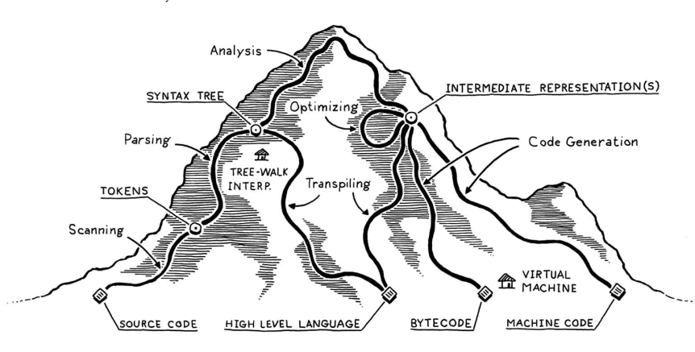
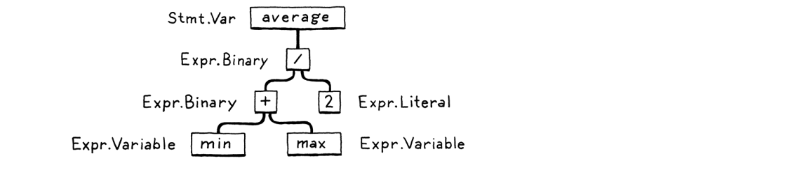
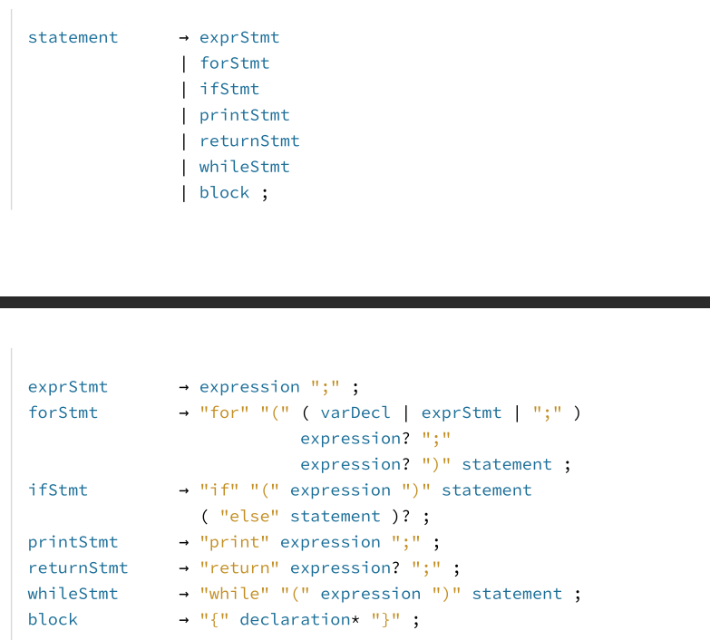
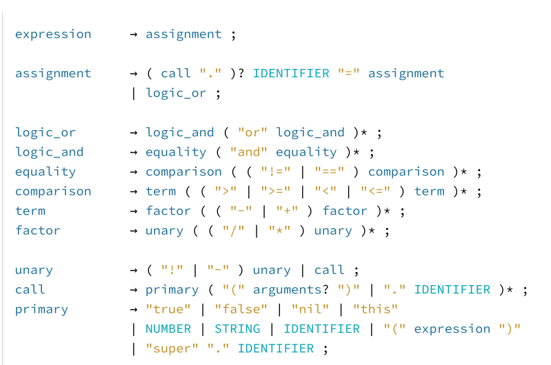
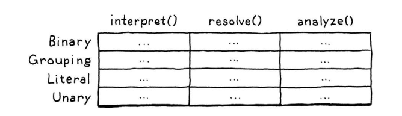

Lox Interpreter in C++

A C++ 20 implementation of the Lox language which is a tree-walk interpreter implemented the following feature.

features of the language are:

- it's dynamically typed- 'var' can store any type.
- Automatic memory management which is done by reference counting and tracing garbage collection.
- control flow
- lexical scopes
- classes & inheritance
- functions & methods
- constructors and fields

Pipeline
source-> scanner-> Tokens-> Parser-> AST-> Resolver-> Interpreter

Scanning(Lexing)
takes linear stream of characters and chucks them them together into a series of something more of a word(Token). while some character or sequence of characters have meaning the others like white spaces, comments doesn't have meaning.

Parsing
a parser takes the list of the tokens from the scanner and produces a tree like structure that mirrors the nested nature of grammar. they are called syntax trees or abstract syntax trees. it gives us the ability to create the higher level statements using out smaller parts(Tokens). which looks like this.

This Syntax tree will also help us figure out syntax errors. it's also used by LSP(Language sever protocol) which guesses what you are trying to do when coding by seeing the whereabouts of the cursor and the AST(abstract syntax tree).

The way the parser handles syntax error is entering panic mode which sounds too much but is necessary to avoid cascading error which is having more errors around because the parser continuing to parse without resolving the previous error causing it to have more error than necessary and to avoid this we use Synchronization which basically get the parser to safe state before going to the next tokens. saves before state-> resolves->goes back.

context free Grammar
-is a set of formal rules(Productions) for generating strings in a language.where those strings define what a valid expression, statements or program looks like.it contains bodies that describe the rule of the grammar which are terminal,non terminal and productions were terminal are tokens which are like literal values and are called terminals because they are endpoints whereas non terminal can be seen as rules that point to other rules till you find a terminal and return it.Production which has a non terminal -> sequence of terminal and/or non terminal. but left side must be one non terminal. This is also where precedence is designed where lower precedence operations appear upper in the grammar and higher ones appear lower in the grammar.

to implement those grammars we have a recursive decent parser which is a top-down parser where we write one function for each non terminal in the grammar. were it consumes tokens and calls other non terminal functions when needed and returns a parsed value. which mirrors the grammar's recursion.

The problem with this tho is that we have an abstract expression and we have different types that inherit from it and all those have different operations and to resolve that in runtime(dynamic polymorphism). and there is a big design issue with dynamic polymorphism you can't easily resolve type and operations at the same time so you have to choose between having a specific number of types or operations and make the code maintainable. And based on this approach having specific number of types was choosen thus the design is Visitor pattern[link to other doc].

Tree-Walk Interpreter
is the execution of code right after parsing it to AST. where the interpreter goes one branch and leaf at a time evaluating each node as it goes. it doesn't compile the code to bytecode or machine code. The AST itself is the executable form.

it inherits from visitors(statement and expression) so it have to implement all the virtual methods at runtime. Those are what it implements...

Expressions

1. visitLiteralExpr: Unwraps and returns the literal value directly (e.g., numbers, strings, booleans, or null).

2. visitGroupingExpr: Recursively evaluates the inner expression inside parentheses and returns its result.

3. visitUnaryExpr: Evaluates the operand, performs runtime type checks, and applies unary operators (like - for arithmetic negation or ! for logical not).

4.visitBinaryExpr: Evaluates the left and right operands, performs strict type checking, and executes arithmetic (+, -, *, /) or comparison (<, >, ==) operations.

5.visitVariableExpr: Queries the current Environment scope chain to look up and retrieve a variable's stored value.

6.visitAssignExpr: Evaluates the right-hand value and updates an existing variable in the appropriate lexical scope environment.

7.visitLogicalExpr: Implements short-circuit evaluation for and and or operators (e.g., skipping the right-hand side of an or if the left-hand side is truthy).

8.visitCallExpr: Evaluates the callee and its arguments, casts the callee to a LoxCallable interface, and invokes its .call() method.

1. visitGetExpr: Evaluates an expression, verifies it is a LoxInstance, and returns the matching property field or method bound to that instance.

2. visitSetExpr: Evaluates the target object and assigned value, ensures the object is a LoxInstance, and updates or creates the target property field.

3. visitThisExpr: Looks up and returns the current class instance using the statically resolved environment distance for the this keyword.

4. visitSuperExpr: Looks up the superclass and current instance from resolved scope distances, then returns the superclass method bound to the current instance.

Statements

1. visitExpressionStmt: Evaluates an expression statement (like a function call or standalone expression) purely for its side effects, then discards the result.

2. visitPrintStmt: Evaluates an expression, converts the resulting object into a human-readable string via a helper stringify() method, and prints it to standard output.

3. visitVarStmt: Evaluates an optional initializer expression and defines a new variable within the current scope's environment.

4. visitBlockStmt: Creates a brand-new child Environment scoped to that block, executes a list of statements within it, and automatically restores the previous environment afterward.

5. visitIfStmt: Evaluates a condition. If truthy, it executes the "then" branch; otherwise, it executes the "else" branch (if present).

6. visitWhileStmt: Continuously evaluates a condition and loops through its body as long as the condition evaluates to a truthy value.

7. visitFunctionStmt: Allocates a new LoxFunction object—capturing the current lexical scope environment as a closure—and binds it to a name in the environment.

8. visitReturnStmt: Evaluates the return value and throws a special Return exception. Because jlox uses Java exceptions to manage control flow unwinding, this exception bubbles all the way out through nested loops and conditionals to catch blocks inside LoxFunction.call().

9. visitClassStmt: Creates a LoxClass object holding its methods and superclass references, binding it to the designated class name.

it's also responsible for environment management where it holds a pointer to the global environment and maintains a mutable environment pointer to know the scope it is in when traversing, truth operation(what's true is decided here) and it's also responsible for runtime error handling.

Command line (any OS)

cmake -B build -G Ninja
cmake --build build --config Release

Usage
python server.py
open <http://localhost:3000>

keywords to define
-segfault
-statement
-maximal munch
-transpilers
-Static analysis- where scopes come to play the region of the code where a certain name can be used to refer to a certain declaration. we have also having binding which is basically finding where name is defined and wire the value and name together. We also check the types of identifiers and if they don't match throw a Type Error.
-Lexical scope
-Dynamic scope
-Shadowing
-closure
-desuggering
-semantic analysis
-fields
