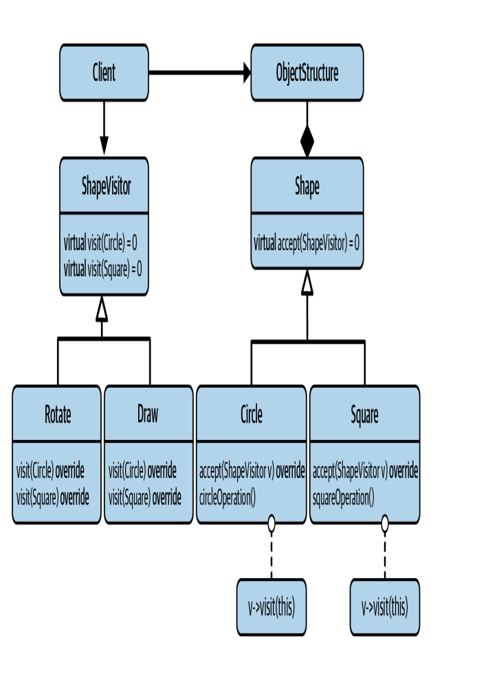
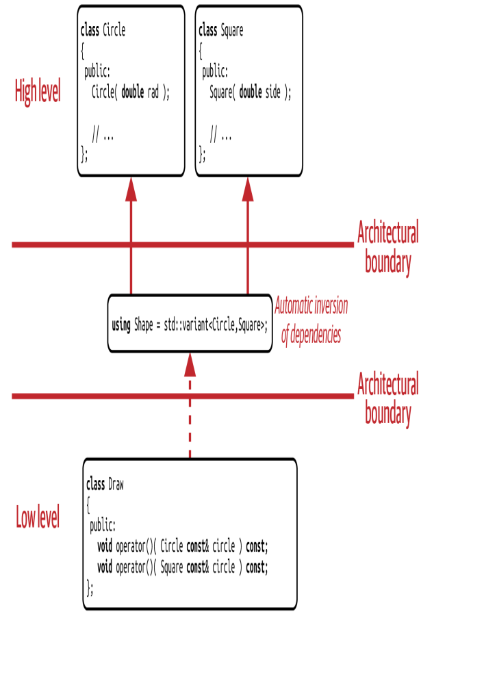

1. # Visitor pattern

The problem is that we have an abstract expression and we have different types that inherit from it and all those have different operations and to resolve that in runtime(dynamic polymorphism). and there is a big design issue with dynamic polymorphism you can't easily resolve type and operations at the same time so you have to choose between having a specific number of types or operations and make the code maintainable. And based on this approach having specific number of types was chosen thus the design is Visitor pattern.

Visitor design approach is one of the classic design patterns. After considering that we have a limited set of types.Visitor lets you define a new operation without changing the classes of the elements on
which it operates.

The Visitor class will be an Abstraction of Base Class. where all the operation will be added to and operation Class will inherit from to implement it for all the derived classes of the Base Class

### Disadvantages

- low implementation flexibility. meaning if we have a method that is similar for every method type then we still need to implement it separately because every virtual method should be overridden by derived class.
- Becomes more difficult to add more types. We have to add a new pure virtual function to the visitor class and implement it in all derived classes.
- there is a cyclic dependency among Visitor class and the base class. To explain the subclasses of the base class depend on the base class and the base class in turn depends on the Visitor because of the accept.
- worst of all it's really slow because pointer chasing of the CPU. where a cache hit really isn't a hit because it gotta see what it's pointing at.

### proposed fix

- using std::variant it takes in any type you give it and will hold the first value by default and holds the space of the largest type. it get initalized the same way we initalize other types and it resizes if the to the same type.
- we remove the need for pointers to know at runtime by changing it to static time. we can get from std::variant using std::get which return value and std::get_if which returns a pointer.

